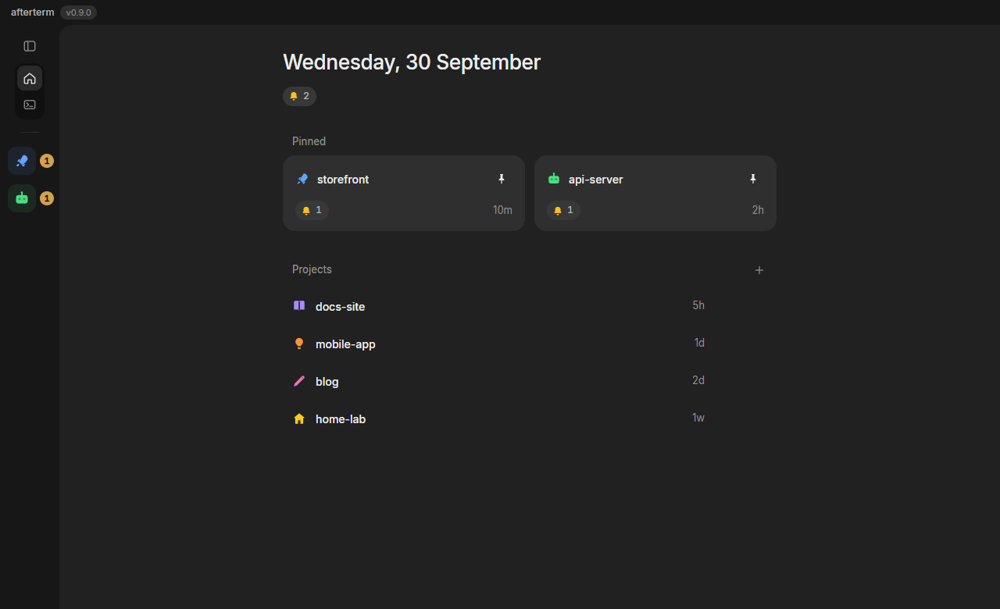
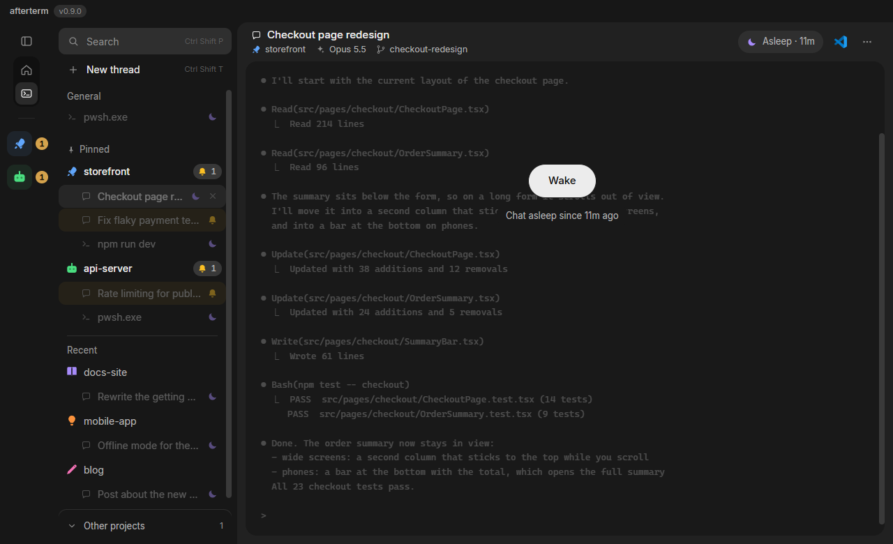

# Changelog

What changed for the person using afterterm, release by release. Each release lists what was added and changed by area, then what was fixed. Every fixed bug, with the PR it landed in, is also in `docs/bugs-fixed.md`. Code-level detail lives in the commit history, `docs/phases-01-projects-and-threads.md` and `CLAUDE.md`.

## Unreleased

### See your Claude usage without leaving afterterm

- **A gauge at the bottom of the rail opens a small Usage card** (or press Ctrl+Shift+U). Nothing is shown or read until you open it.
- **Limits tab:** your current session, this week, and this week's Fable usage, each with a bar, how much is used and when it resets. The bar turns yellow from 75% and red from 90%.
- **Breakdown tab:** what is using your limits, with tips (a tip at 50% or more is yellow), then your skills, subagents and MCP servers. It arrives a few seconds after the limits.
- **It reads the numbers from Claude Code itself.** afterterm starts a hidden Claude Code, runs `/usage`, reads the screen and closes it. It uses no model, never touches your login, and changes none of your settings. The first time, Claude Code asks to trust afterterm's own usage folder and afterterm answers yes for that folder only.
- **Every time you open the card, and every time you press refresh, it reads again.** The card shows its loading skeleton meanwhile, so old numbers are never mistaken for fresh ones.

### What's new now shows every version you skipped

If you were a few versions behind, What's new used to show only the newest version's notes.

- **Every version since yours is listed**, newest first, each with its date. The newest is open; click any other version to read it.
- **The update notice says how many versions came out** since yours, for example "You have 0.12.1. 2 versions came out in between."
- **After the update**, What's new is titled "What's new since 0.12.1" and lists the same versions.
- **If you skipped more than ten versions**, the last line links to the older ones on GitHub.

## 0.17.0 (2026-11-09)

### Added

- **You can now drag the sidebar's right edge to make it wider or narrower.** It stops at a narrow minimum and at half of the window, and double-clicking the edge puts it back to its normal width. afterterm remembers the width the next time you open it.
- **If afterterm's window crashes or freezes, it now comes back by itself with every thread still running.** Before, the only way out was ending one of afterterm's processes by hand, and closing the app would have stopped every shell and chat. Now a window that crashes, or freezes and stays frozen, loads again on its own, on the same screen and thread, and each terminal joins the same shell, chat or server it had. A chat that was waiting for you still shows it. You see each terminal's current screen again, but not the older lines above it, and anything printed while the window was down is not kept.

### Fixed

- **You can select text in the terminal again after searching with the find bar.** After you searched, the terminal kept jumping the selection back to the search result whenever new output arrived, so your own selection was lost within a moment. Now clicking in the terminal ends the search: the highlights and the match count go, the bar keeps its text, and your selection stays. Press Enter or an arrow in the bar to search again.
- **Turning off afterterm's Command Prompt integration now works in a second copy of afterterm that you start from a Command Prompt inside afterterm, such as the test build.** The integration adds invisible marks to a prompt, so afterterm can tell where each command starts and which folder the shell is in. Before, the second copy inherited the first one's prompt with the marks already in it and added them again, so each prompt carried them twice, or carried them even with the integration turned off. Now it takes the first set out, keeps your own prompt, and adds the marks once, or not at all when you have turned the integration off. Git Bash and WSL started that way no longer inherit afterterm's prompt hook either.
- **The worktree item and the editor button in a chat's header now open the worktree's own folder, not a folder inside it.** A worktree is a separate checkout of your repository that a chat can work in. Before, once Claude had moved into a subfolder, these opened that subfolder. Open in File Explorer and Open in your editor in a thread's right-click menu do the same. A thread in an ordinary repository opens the repository's top folder, unless that is above its project, and then it opens the project's folder. A thread outside git still opens its own folder.
- **Notification toasts now appear above every ordinary window.** Before, a toast could arrive behind the windows in front of you, for example behind another app's always-on-top window, and stay there unseen. Each toast now puts itself back on top when it appears. While a full-screen app or a presentation is in front, toasts wait instead (next item).
- **Toasts wait while a full-screen app or a presentation is in front, and show once you leave it.** While a full-screen app, a full-screen game or a presentation is in front, on any of your screens, afterterm keeps its toasts waiting, the way Windows' own notifications do, and shows them within a few seconds of you leaving it. A toast already on screen when you go full screen is hidden too, and comes back when you leave. Toasts are never held for afterterm's own full screen. The sidebar and the rail still show every thread's state meanwhile.
- **afterterm now opens where you left it, and comes back to its screen after the laptop sleeps.** Before, it always opened in the middle of the main screen, and after you closed the lid with afterterm on a second monitor, Windows moved it (and its toasts) to the main screen and it stayed there. afterterm now remembers which screen and where you put its window, opens there, and moves back when that screen returns after sleep, unless you moved the window yourself in the meantime.
- **Pressing Ctrl+Shift+R no longer sends afterterm to Home and puts every thread to sleep.** That key, and Ctrl+R outside a terminal, reloaded afterterm's window, which sent it to Home and put every thread to sleep. No key reloads the window now. Ctrl+R still reaches the terminal, where it searches your command history in PowerShell and bash.
- **When afterterm's window reloads, for example after a crash, every thread now stays awake and keeps running.** Before, the threads came back asleep while their shells kept running out of sight, and waking one started a second shell beside the first.
- **When the graphics fail, afterterm now redraws every terminal's text by itself.** Before, after the graphics process ended or the driver reset, a terminal could show no text until you changed its font size, one terminal at a time.
- **Text in a chat now appears twice on screen far less often.** Claude Code redraws its screen each time the terminal changes size, and when the terminal got narrower, the top of the old screen stayed behind above the new one, so the same lines showed twice. afterterm now changes a chat's size only when it must: coming back from Home no longer makes it wider and then narrower again, dragging the window's edge resizes it once when you let go instead of at every pause, and a thread woken while out of view already has the right size when you open it. Making the window or the sidebar narrower can still leave one copy, since that is how Claude Code redraws.
- **The Other projects list at the bottom of the sidebar now closes when you click anywhere outside it, press Esc, or switch to another window.** Before, it stayed open until you clicked its own row again, even when you clicked in the terminal, the header or the rail.
- **A chat's hourglass now stays for as long as its background agent or task is running.** Before, it went away the moment you opened the chat, and a chat you were looking at when its turn ended never showed it at all, so a subagent at work was invisible in the sidebar, on the project's row and in the header. It now goes when the background work ends.
- **The compacting icon now goes away when you cancel a compaction.** Compacting is Claude Code shortening a long chat to make room. Before, the icon stayed on the rail and the sidebar row until you opened another thread. It now clears as soon as you press Esc, and otherwise within a few seconds of the compaction stopping.

## 0.16.1 (2026-11-08)

### Fixed

- **A long link that ran onto a second line opened only half of the address, or nothing.** Now clicking any line of it opens the whole link, even after you change the font size.

## 0.16.0 (2026-11-08)

### Fixed

- **The "Restart afterterm to update?" window now says "Stops mid-turn" for a chat that is in the middle of a reply.** Before, such a chat could read "Safe to restart", for example when its hooks (the small scripts Claude Code runs so afterterm knows what a chat is doing) were missing, or when Claude paused for a few seconds. A chat waiting at a question or a permission prompt counts too, from the moment it asks.
- **The same window now says "Background task stops" for a chat that still has a background task running.**
- **It now says "Command stops" for a shell that is running a command,** such as a long `ping` or PowerShell's `Start-Sleep`. A chat you have exited says it too while its shell runs something.
- **It says "Safe to restart" only when every thread is known to be idle.** When it cannot tell what a shell is doing, it shows no status line at all, instead of calling the restart safe.
- **A chat whose session was never recorded by the hook now still comes back as a chat, and resumes after a restart or a wake.** afterterm now also reads Claude Code's own record of the running session, so such a chat gets the chat icon within a couple of seconds of its first message. Before, it came back as a plain terminal.
- **A chat you exited stays a chat,** and Wake resumes its conversation.
- **A chat that started its own dev server now resumes the chat on Wake.** Before, Wake started a new Claude session instead. The question asked before putting such a thread to sleep now says "Wake resumes the chat."
- **The spinner in the sidebar no longer drops out when Claude pauses in the middle of a reply,** and it now shows for a chat whose hooks are missing.
- **afterterm now puts its Claude Code hooks back within a few seconds if they go missing while it runs.** Hooks are what give a chat its working, done and needs-you states and its toasts. Before, they stayed missing until the next launch.
- **Turning Claude notifications off no longer removes another tool's hook** that shares a group with afterterm's in the Claude Code settings. Only afterterm's own hook goes.
- **Starting a test copy of afterterm with a throwaway profile can no longer remove the real Claude Code hooks.** On 2026-11-06 that left every chat without its states and toasts for 21 hours.

## 0.15.0 (2026-11-06)

### You can now give a project any colour you want

Before, a project could only use one of eight set colours.

- **To try it:** right-click a project, choose **Edit project**, then click the large icon at the top of the window.
- **To pick any colour:** click the rainbow circle at the end of the row, then drag on the wheel. The large icon changes as you drag.
- **To make it brighter or darker:** drag the bar beside the wheel.
- **If you know the exact colour:** type its code in the box under that bar, like `#22c55e`.
- **White** is also new, next to yellow.

### The window for creating or editing a project is now much smaller

It used to show every option at once and filled most of the screen.

- **Colours and icons** stay hidden until you click the large icon.
- **The project's name** now comes first, above its folder.
- **The shell** is now a dropdown instead of a long list. The shell is the kind of terminal a new thread opens, like Command Prompt or PowerShell.
- **The "Default shell" option is gone.** It only ever opened Command Prompt, so projects that used it still do.

### You can now rename a thread or a project

A thread is one chat or terminal in the sidebar.

- **To rename a thread:** right-click it in the sidebar, choose **Rename**, type a name and press Enter.
- **Your name stays.** Claude Code usually changes a chat's name as it goes, but it won't change one you named yourself.
- **To get the automatic name back:** choose **Rename** again, clear the box and press Enter.
- **To rename a project:** right-click it and choose **Rename**.

## 0.14.0 (2026-11-06)

### Clicking a file in the terminal now opens it in the right app

When Claude mentions a file in the terminal, you can click its name to open it. Before this, nearly everything opened in VS Code, even videos and web pages. Now:

- **Videos, music, pictures, web pages, PDFs and Office documents** open in the app you normally use for them. A video plays in your video player, and a web page opens in your browser.
- **Code files and Markdown notes** still open in VS Code. If you don't have VS Code, they open in Notepad.
- **Opening a file never runs it.** A script opens so you can read it. It does not start.

### Right-click a file in the terminal for more options

Right-clicking a file name in the terminal now shows a small menu:

- **Open** opens the file.
- **Open file location** shows the file in File Explorer.
- **Copy file path** copies the file's full location, ready to paste somewhere else.

Right-clicking anywhere else in the terminal still pastes, the same as before.

### Click an image tag to see the image

When you paste an image into a chat, Claude Code shows it as a tag like `[Image #1]`. You can now click that tag to open the image. Right-clicking the tag shows the same menu as above.

### Fixed

- **Without VS Code, clicking a script started it.** Now it opens in Notepad and does not run.
- **A long file location with spaces in it stopped being clickable when it ran onto a second line.** You can now click it on either line.
- **Clicking a pasted image could open the wrong one.** If two images in a chat had the same number, you got the older one. Now you get the newest.

## 0.13.0 (2026-11-03)

### Two threads side by side

- **Drag a thread from the sidebar onto either half of the open terminal** to show the two side by side. The half it will take lights up while you drag. Two threads of the same project can go together, or two General threads.
- **A drop that can't work turns red and says why:** "Same project only" for a thread from another project, "Two at most" when two threads are already on screen. Letting go there does nothing.
- **Each half is a whole thread:** its own header, menu, editor button, Files button and Wake. A thin outline shows which half you are typing in; click a half to type there.
- **The other half still tells you things.** It gets its toasts while you work in the focused one, and its Done stays until you click into it.
- **In the sidebar the two rows stay in their project, joined by a thin line.** Clicking either one shows both. Ctrl+Shift+Down and Ctrl+Tab step through both halves one after the other.
- **Drag the divider to resize**, between a quarter and three quarters; double-click it for half and half.
- **Right-click either row and choose Ungroup** to show them apart again; both keep running. Closing either thread, or moving it to another project, also ends the pair.
- The pair, its sides and the divider come back after a restart, both asleep.

### The header's status is shorter

- A working chat's header shows the spinner alone, without "Working".
- A running server's header shows the play icon and its port (`:5173`), without "Running on".

## 0.12.1 (2026-11-01)

### Fixed

- **Update** now always downloads the newest version.

## 0.12.0 (2026-11-01)

### The sidebar keeps its order

- **Nothing moves because you used it.** Opening a chat, typing in a thread, a notification or a wake no longer moves a project or a thread in the sidebar. Each project in Recent keeps its place.
- **New arrivals go on top.** A project that comes into Recent (opened from Home, Other projects or the search palette, or one of its threads woken) goes at the top, and the rows below slide down. A new or resumed thread goes at the top of its project the same way.
- The order is kept when afterterm restarts. Home's Projects list still goes by recent activity.

### Drag and drop in the sidebar

- **Move projects.** Drag a project up or down inside Pinned or Recent. Drop one into Pinned to pin it, or drag a pinned one down into Recent to unpin it.
- **Move threads.** Drag a thread between two threads, in its own project or another, or drop it on a project's row to put it at the top of that project. Drop it on or above the Pinned heading to take it out of its project into General.
- A line shows where the row will land, including above the first one. The dragged row floats beside the pointer, and a thread moving to another project shows where it comes from and where it goes. Esc, or letting go where it already was, puts it back.

### Archive moves a project to Other projects

- **Archive** now moves the project to the top of the **Other projects** drawer at the bottom of the sidebar, instead of hiding it everywhere except Home.
- A project with awake threads asks first, listing each one with its status. On **Archive** they go to sleep one after the other, the project folds away, and "Moved to Other projects" says where it went.
- Opening it, waking one of its threads, or **Restore** in its menu brings it back to the top of Recent. An archived project now has the full project menu.
- Home's Archived section is gone: archived projects are listed in Projects like any other, and the search palette finds them too.

### Fixed

- Projects in Recent swapped places while you worked in two of them.
- Opening a chat from another project moved that project to the top of Recent, with no animation.
- Projects could not be reordered by dragging, dragging into Pinned did not pin, and a thread could not be dragged out of its project.
- Archiving a project hid it everywhere except Home, instead of moving it into Other projects.
- The search palette did not list archived projects.

## 0.11.2 (2026-10-31)

### Fixed

- The installer's progress bar, during an update or a reinstall, went from nearly full back to about a third before it finished. It now only moves forward.

## 0.11.1 (2026-10-31)

- The first update afterterm installs by itself: on 0.11.0, this version arrives as **Update available**.
- The README says how to install, what to do when Windows warns about the installer, and that afterterm updates itself.

## 0.11.0 (2026-10-31)

### Updating afterterm

- **afterterm updates itself.** An installed afterterm checks GitHub for a new version shortly after it starts and every 6 hours. When one is out, an **Update available** button appears beside the version number at the top left. Nothing opens by itself.
- **The notice.** Clicking the button shows the new version, **What's new** (it folds open inside the notice), **Update**, **Later** (hides it for a day) and **Skip this version**.
- **Downloads while you work.** The button shows the download's progress, then becomes **Restart to update**. The download is checked against the checksum GitHub publishes for the release; one that does not match is deleted and never runs.
- **It asks before it restarts.** "Restart afterterm to update?" lists every awake thread and what happens to it: a chat resumes, a server runs its command again, a shell opens in its folder, and a chat in the middle of a reply, or waiting for your permission, is marked "Stops mid-turn" (afterterm resumes the chat, but you send that last message again).
- **Back where you were.** A small window shows the install's progress, then afterterm opens on the thread that was open, wakes the threads that were awake, and shows "Updated to" with What's new. Only an update restart wakes threads: a normal quit still brings everything back asleep.
- **About afterterm.** Click the version number for the About window: check for updates by hand, read What's new, or turn **Check for updates automatically** off.
- Anyone on 0.10.0 or older installs this version by hand, once; updates are automatic from then on.

### Fixed

- Reinstalling afterterm into a folder you had chosen offered the default folder again: Setup did not find the earlier install.
- Opening afterterm while it was already open started a second copy, and the two overwrote each other's projects and threads. Now it brings the open window forward.

## 0.10.0 (2026-10-30)

### Installing afterterm

- **A real installer.** afterterm now comes as one `afterterm-<version>-setup.exe`: pick the folder, choose a desktop and a Start menu shortcut, and it installs for you alone, with no admin prompt. It appears in Settings > Apps with an uninstaller. Your projects and threads stay where they were, so installing over an earlier copy keeps them.
- **It checks Claude Code before it finishes.** If Claude Code is installed, the last step tests that afterterm's helper runs on this PC and that a chat can be saved, and says so. If something blocks it, it names the cause and offers **Report issue**, which opens a GitHub issue filled in with what went wrong (never your files or chats).
- **No Claude Code, no question.** Without Claude Code installed, setup says nothing about it.

### Starting afterterm

- **Nothing starts on its own.** A fresh install opens on Home with no terminal running; closing your last thread returns to Home instead of opening a new one.
- **Create your first project.** With no project yet, Home shows one large button to create it.
- **No more empty Recent heading** in the sidebar. The New project button moves to Pinned when there is no recent project, or becomes its own row when there are no projects at all.
- **The logo** has clean rounded corners at every size.

### Fixed

- A chat did not come back after Sleep and Wake on a PC where Windows blocks scripts by default, which is most home PCs. afterterm's helper for Claude Code now runs there, and installing or starting this version repairs the helper set up by earlier versions.
- A chat opened with `/resume` and left without a message was lost on Sleep.
- afterterm froze for a few seconds after starting, the mouse included, while it looked for your code editor.

## 0.9.0 (2026-09-30)

This release changes what afterterm is built around. It used to show you a list of terminals; now it shows you your work: the projects you care about, and the Claude Code chats and shells inside each one. It tells you which of them need you, and anything you are not using sleeps until you ask for it.

Three words used below: a **thread** is a Claude Code chat or a shell inside a project (0.8.1 called it a tab). A thread is **asleep** when nothing runs in it: afterterm keeps its last output and starts it again when you wake it. The **rail** is the narrow strip at the left edge, with a tile for each project that has something going on.

### The biggest changes

- **Projects and threads.** Pin the projects you are working on; each holds its chats and shells. A chat is named after its conversation and shows its model, branch and worktree.
- **Everything starts asleep.** After a restart every thread shows its last output and runs nothing until you wake it; waking a chat resumes its Claude Code session.
- **See what needs you.** A chat asking for permission stays marked until you answer it, and the rail shows every project with a thread waiting, working or finished.
- **Files a chat changed.** A Files button lists the documents, code and pasted images a chat changed, and file paths in Claude's replies are clickable.
- **Servers by their port.** A thread running a dev server shows its port, opens it in your browser, and starts it again when you wake it.

### Upgrading from 0.8.1

- Your tab groups become projects and your tabs become threads. afterterm converts your saved session the first time it starts. Tab groups and the Projects shelf are gone.
- Every thread opens asleep. Threads carried over from 0.8.1 show no saved output the first time, since 0.8.1 kept none; press Wake to resume a chat's Claude Code session or to open a fresh shell in its folder.
- Nothing resumes on its own any more. 0.8.1 resumed the chat that was open when you quit, and each other one the first time you clicked it; now opening a thread only shows it, and it resumes when you wake it.
- Ctrl+Shift+T now opens a chooser for the new thread's project and shell, instead of opening a tab straight away.

### Installing

Download `afterterm-0.9.0-setup.exe` below and run it. It asks for a folder and unpacks `afterterm-win32-x64` there; start `afterterm.exe` from inside it. To replace an older copy, close afterterm first and unpack to the same place. Your projects and settings are kept in `%APPDATA%\afterterm`, so they carry over.

### All changes, by area

#### Projects and Home

- The app opens on Home: your pinned projects as cards, the others by recent activity, and an Archived section.
- Pin a project to keep it at the top; archive one to take it out of the sidebar without deleting it.
- A project has a folder, a name, a colour, an icon and a default shell, all set in one dialog.
- Each project has a page listing its threads (live, asleep and closed), with buttons to open its folder in File Explorer or in your editor (VS Code, Cursor and others are detected).
- The sidebar shows your pinned projects, then the ones used in the last three days, with the rest folded into Other projects at the bottom. A search box at its top filters it as you type.
- Ctrl+Shift+P searches every project, thread and closed thread.

#### Threads

- A chat's header shows its project, model, branch and worktree.
- Sleep any thread from its menu; its last output stays on screen until you wake it.
- Closing a thread files it in its project's history, where a chat can be resumed.
- Hovering a thread shows its status, model, branch, last command and when it was last used.
- A thread's menu and its header open the thread's own folder in File Explorer or your editor; for a chat working in a worktree, that is the worktree.
- A chat that moved to another worktree outside afterterm shows the new branch and resumes there.

#### What needs you

- A chat asking for permission or asking a question stays marked until you answer it, not just until you look at it. A finished turn shows as done until you open the chat.
- Mark a chat as unread to come back to it later.
- The rail shows a tile for every project with a thread waiting, working, finished or compacting, with counts beside it. Clicking a tile opens the thread that most needs you.
- A chat whose turn ended with background tasks still running shows an hourglass instead of the working spinner.

#### Files a chat changed

- A chat's Files button lists the documents it changed first, then its code and the images you pasted into it, including files changed by its subagents and by its shell commands.
- File paths in the terminal are links: a click opens the file, at the line for `file.ts:42`. Bare file names, paths with spaces and paths broken over two lines work too.

#### Servers

- A thread running a dev server shows its port, and Open localhost opens it in your browser.
- Closing or sleeping a server thread asks first; waking it runs the server's command again.

#### Shells

- Command Prompt, PowerShell 7, Windows PowerShell, Git Bash and WSL all tell afterterm which folder they are in, so a thread reopens where you left it and its branch follows `cd`. Custom prompts are kept. To turn this off for a shell, use `shellIntegration` in `%APPDATA%\afterterm\prefs.json`.

#### Pop-up notifications

- A pop-up shows the thread's name and its project, in the project's colour and icon.

#### Long output

- A round button appears while you scroll through long output, to jump to the top or the bottom.

#### Look

- A new look throughout. Its animations turn off when Windows is set to reduce motion.

### New and changed keyboard shortcuts

| Shortcut | What it does |
|---|---|
| Ctrl+Shift+T | Changed: opens the chooser for a new thread's project and shell |
| Ctrl+Shift+P | New: searches projects, threads and closed threads |
| Ctrl+Shift+Down, Ctrl+Shift+Up | New: the next and previous thread in sidebar order, across projects |

### Bugs from 0.8.1 that are fixed

- Pop-up notifications stayed until you closed them. While you are using afterterm they now go after 5 seconds (resting the pointer on one keeps it), and one that arrives while you are in another app waits until you come back.
- A chat that published or watched an artifact kept showing background tasks after its turn ended. It now shows done.
- The chat you were looking at kept showing background tasks after Claude's turn ended. It now clears at once.
- A pop-up kept a project's old name after you renamed the project. It now updates.
- Pop-ups appeared on the main monitor when afterterm was on another one. They now appear on afterterm's monitor.

### Known problems in this release

- A white bar sometimes appears above the pop-ups, most often when several are stacked.
- After a restart, threads lose their waiting and finished marks; only Mark as unread survives.
- Clicking a file link opens it in VS Code, even when it is a video or a web page.
- Opening a chat moves its project to the top of the recent projects, even if you typed nothing.
- After the laptop sleeps, the afterterm window can move to the main monitor and stay there.

Full list of changes: https://github.com/afteraryan/afterterm/compare/v0.8.1...v0.9.0

## 0.8.1

A tab no longer auto-resumes a Claude session that never existed (the hook's session capture is limited to real turns).

## 0.8.0

Project groups: a tab group has a name, a folder, a colour and a default shell, and survives having nothing running in it. The Projects shelf holds groups with no terminals.
